MITK Diffusion
==============

Copyright © German Cancer Research Center (DKFZ), [Division of Medical Image Computing (MIC)](https://www.dkfz.de/en/mic/index.php). Please make sure that your usage of this code is in compliance with the code [license](https://github.com/MIC-DKFZ/MITK-Diffusion/blob/master/LICENSE.txt).

[](https://zenodo.org/badge/latestdoi/195387051)

The MITK Diffusion application [[1,2]](#References) offers a selection of image analysis algorithms for the processing of diffusion-weighted MR images. It encompasses the research of the Division of Medical Image Computing at the German Cancer Research Center (DKFZ).

* [Features](#Features)
* [Related Links](#Related-Links)
* [Image Gallery](#Image-Gallery)
* [Building MITK Diffusion from source](#Building-MITK-Diffusion-from-source)
* [User Manual](http://docs.mitk.org/diffusion/nightly/)
* [Report a Bug](https://github.com/MIC-DKFZ/MITK-Diffusion/issues)
* [References](#References)
* [Contact](#Contact)

## Features

**Support for most established image formats**
* Images: DICOM, NIFTI, NRRD (peak and SH images compatible with MRtrix)
* Tractograms: fib/vtk, tck and trk.

**Image preprocessing**
* Registration
* Head-motion correction
* Denoising
* Resampling, cropping, flipping and merging
* Header modifications
* Single volume extraction

**Diffusion gradient/b-value processing**
* b-value rounding
* Gradient direction flipping
* Gradient direction subsampling
* Averaging of gradient directions/volumes
* Gradient direction and b-value visualization

**ODF reconstruction and signal modelling**
* Tensor and Q-ball reconstruction
* ODF peak calculation
* MRtrix or camino results can be imported

**Quantification of diffusion-weighted/tensor/ODF images**
* Intravoxel Incoherent Motion (IVIM) and diffusion kurtosis analysis
* Calculation of many other derived indices such as ADC, MD, GFA, FA, RA, AD, RD
* Image statistics

**Segmentation**
* Manual image segmentation and operations on segmentations

**Fiber tractography**
* Global tractography [[4]](#References)
* Streamline tractography
    * Interactive (similar to [[5]](#References)) or seed image based
    * Deterministic or probabilistic
    * Peak, ODF, tensor and raw dMRI based. The latter one in conjunction with machine learning based tractography [[6]](#References)
    * Various possibilities for anatomical constraints.
    * Tractography priors in form of additional peak images, e.g. obtained using TractSeg

**Fiber processing**
* Tract dissection (parcellation or ROI based)
* Tract filtering by
    * length
    * curvature
    * direction
    * weight
    * density
* Tract resampling and compression
* Tract transformation
    * Mirroring
    * Rotating and translating
    * Registration (apply transform of previously performed image registration)
* Tract coloring
    * Curvature
    * Length
    * Weight
    * Scalar map (e.g. FA)
* Other operations
    * Join
    * Subtract
    * Copy
* Fiber clustering [[7]](#References)
* Fiber fitting and weighting similar to SIFT2 and LiFE [[8,9]](#References)
* Principal direction extraction (fibers --> peaks)
* Tract derived images:
    * Tract density images
    * Tract endpoint images
    * Tract envelopes

**Fiberfox dMRI simulations** [[10]](#References)
* Multi-compartment signal modeling
* Simulation of the k-space acquisition including
    * Compartment specific relaxation effects
    * Artifacts such as noise, spikes, ghosts, aliasing, distortions, signal drift, head motion, eddy currents and Gibbs ringing
    * Definition of important acquisition parameters such as bvalues and gradient directions, TE, TR, dwell time, partial Fourier, ...
* Manual definition of fiber configurations, e.g. for evaluation purposes
* Automatic generation of random fiber configurations

**Other features**
* Integrated screenshot maker
* Command line tools for most functionalities

## Related Links
* Great python package for logging your (MITK or other) command line experiments:
    * https://github.com/MIC-DKFZ/cmdint
    * `pip3 install cmdint`
* TractSeg reference data of 72 semiautomatically defined bundles in 105 HCP subjects: https://zenodo.org/record/1285152
* TractSeg python package: https://github.com/MIC-DKFZ/TractSeg
* Simulated dMRI images and ground truth of random fiber phantoms in various configurations: https://doi.org/10.5281/zenodo.2533250
* ISMRM 2015 Tractography Challenge Data: https://doi.org/10.5281/zenodo.572345 & https://doi.org/10.5281/zenodo.1007149


## Image Gallery

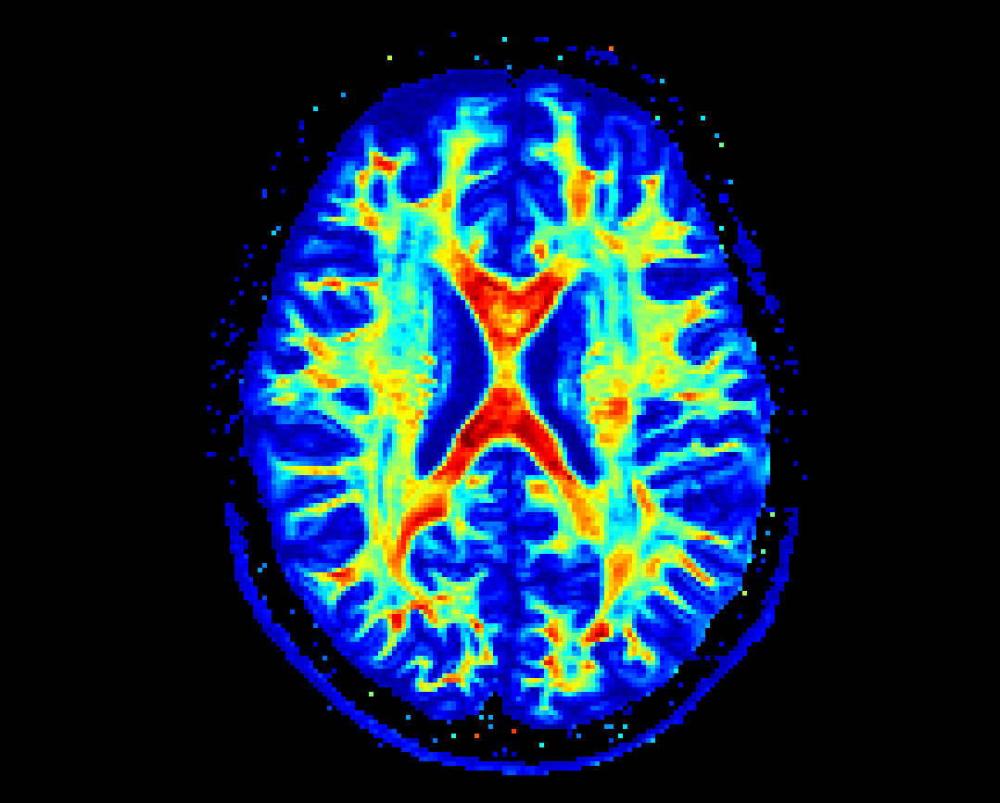 Scalar map visualization
<br/><br/><br/>

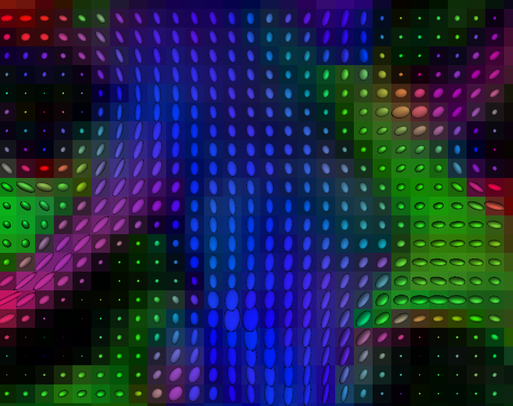 Tensor Visualization
<br/><br/><br/>

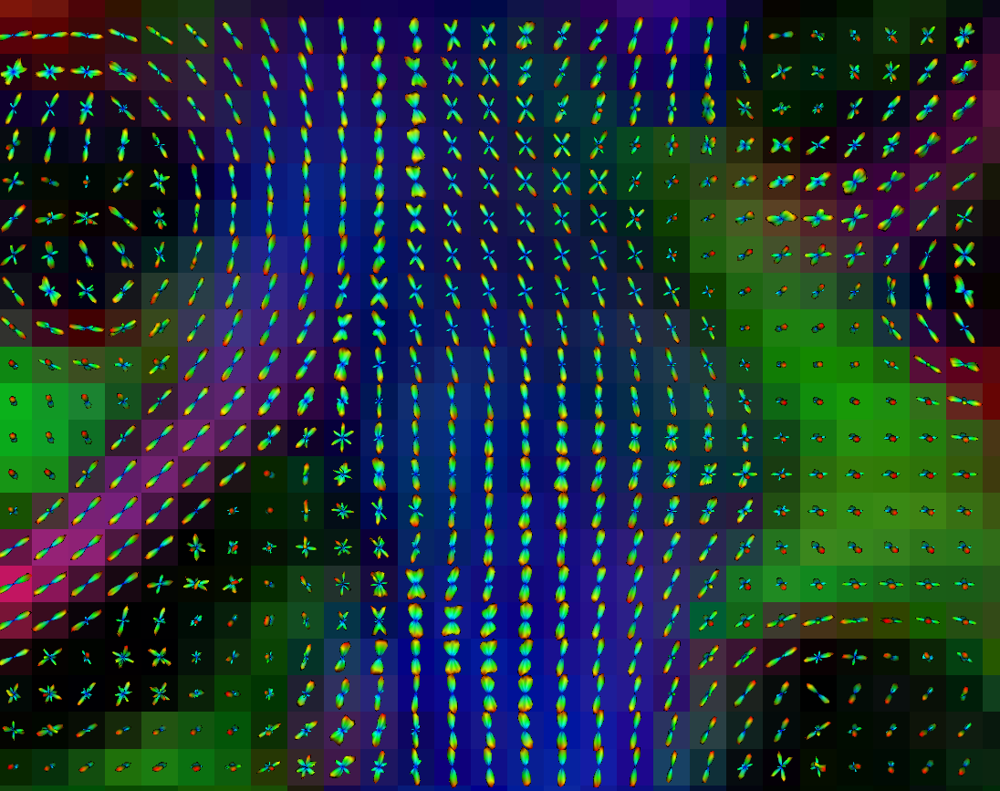 ODF visualization
<br/><br/><br/>

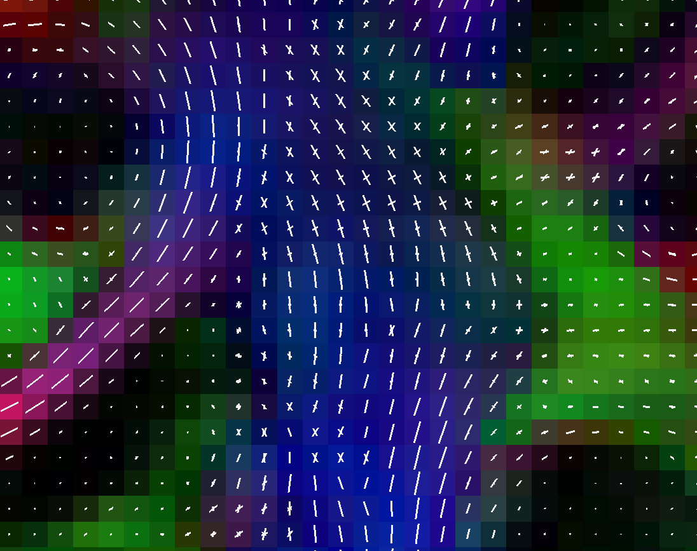 Peak visualization (uniform white coloring)
<br/><br/><br/>

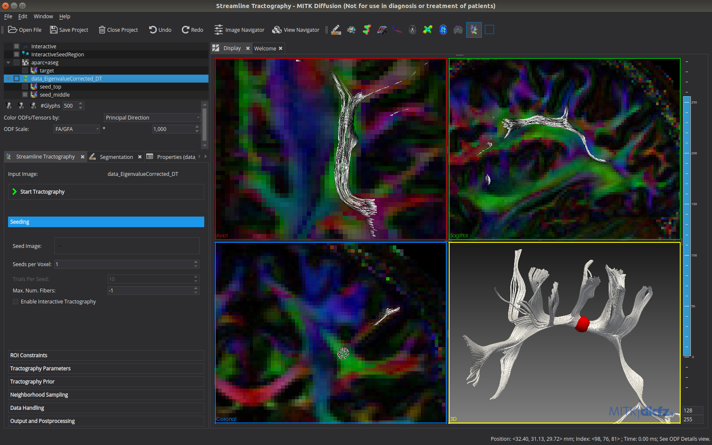 Interactive tractography in MITK Diffusion. The tractogram updates automatically on parameter change and movement of the spherical seed region.
<br/><br/><br/>

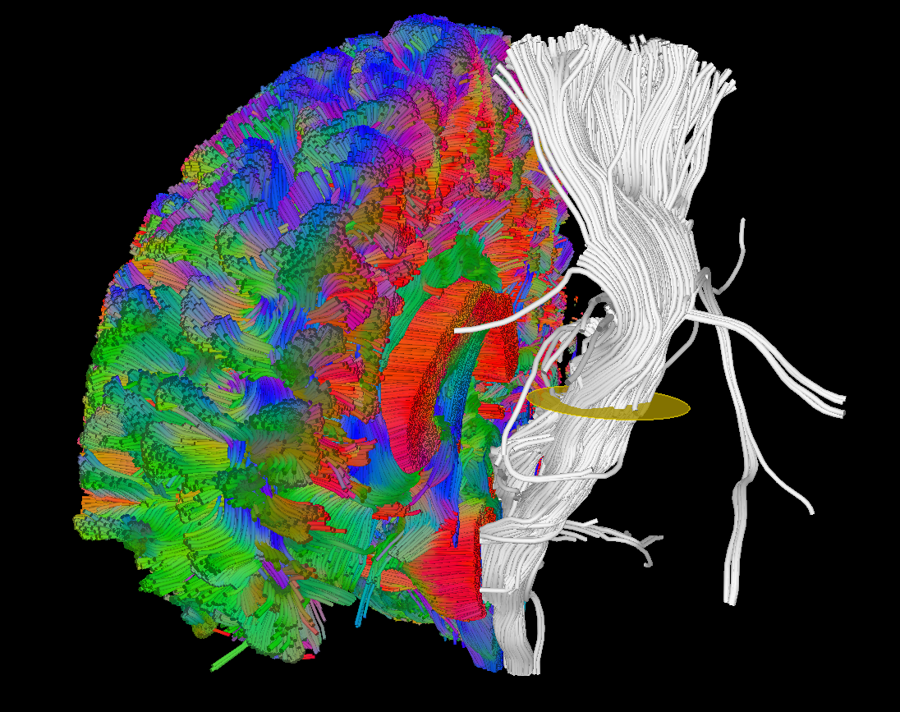 Tract dissection using manually drawn ROIs.
<br/><br/><br/>

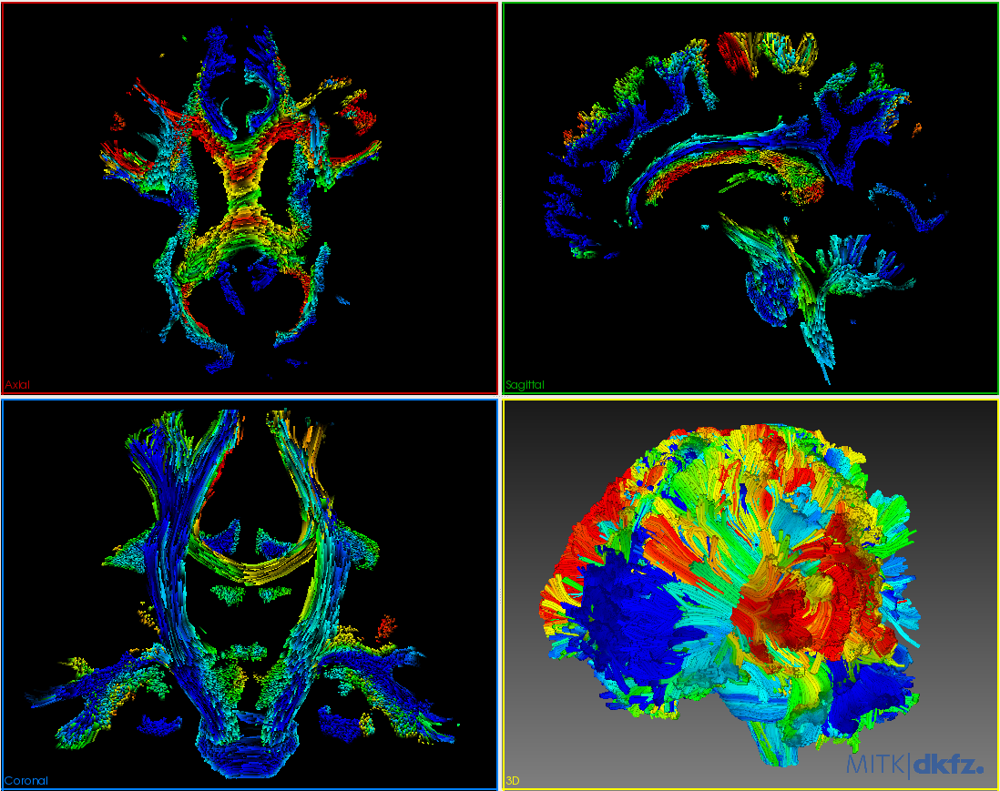 Automatic streamline weighting (similar to SIFT2 or LiFE)
<br/><br/><br/>

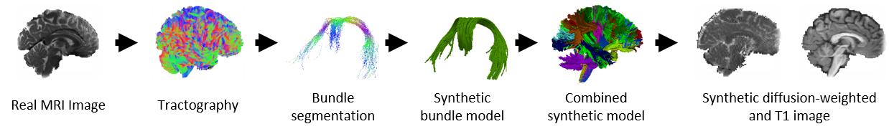 Illustration of the dMRI phantom simulation process using Fiberfox.
<br/><br/><br/>

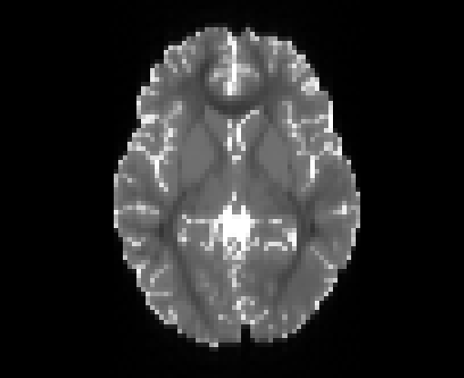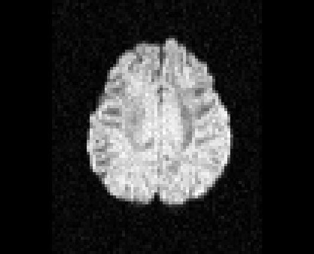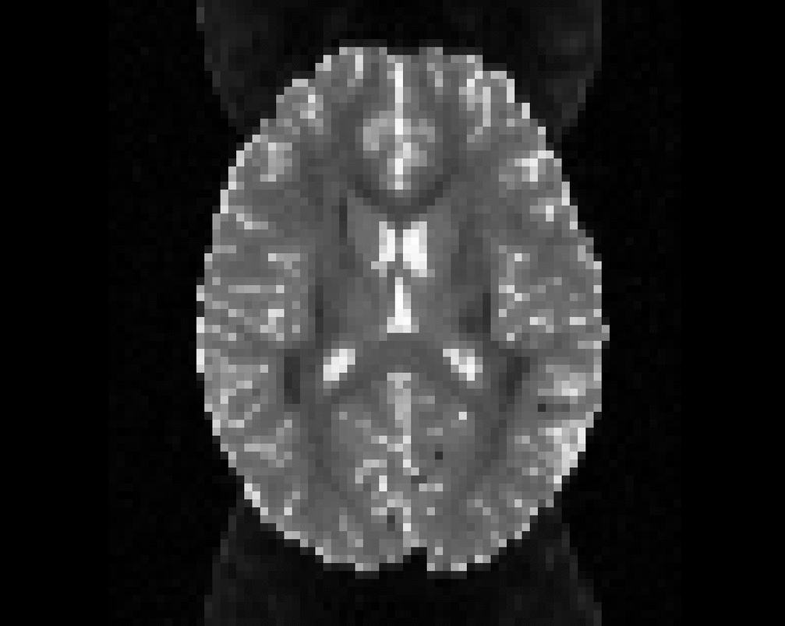
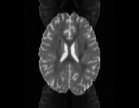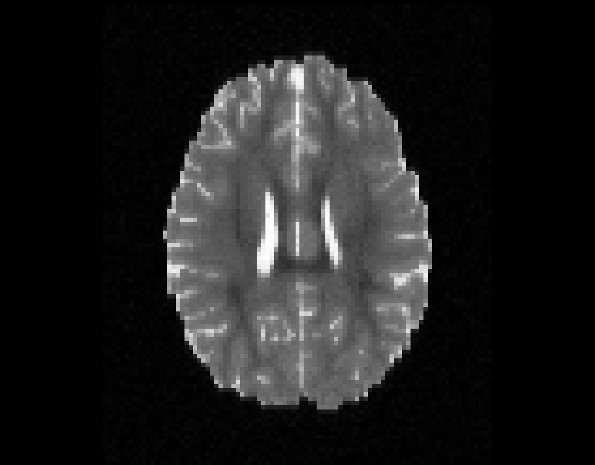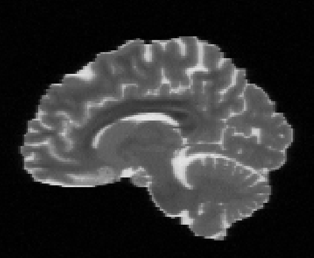\
Illustration of simulated dMRI images with various artifacts (a bit excessive for illustration purposes): eddy current distortions (1), motion and spike (2), intensity drift (3), motion, eddy and noise (4), ringing (5), B0 inhomogeneity distortions (6), from left to right.
<br/><br/><br/>

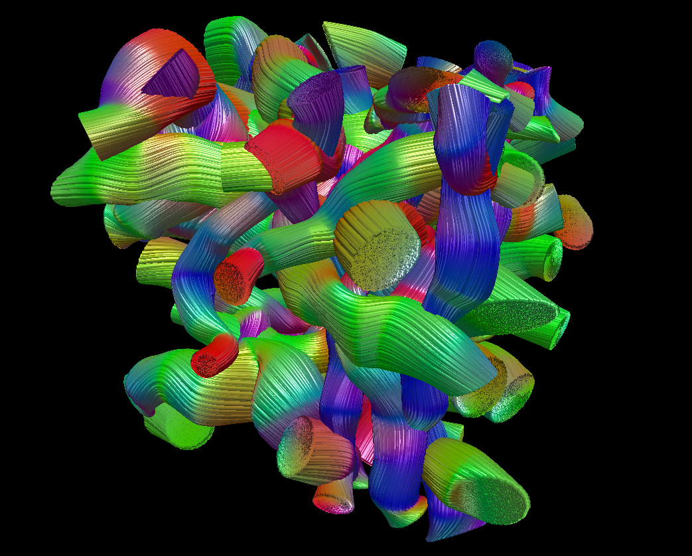
Automatically generated random fiber configuration for Fiberfox simulations.
<br/><br/><br/>


## Building MITK Diffusion from source

MITK Diffusion has no application of its own. It is an extension of [MITK](https://github.com/MITK/MITK): the MITK superbuild picks it up through `MITK_EXTENSION_DIRS` and builds the MITK Workbench with the diffusion plugins, plus the command line apps.

MITK Diffusion follows the MITK `develop` branch; it does not build against the MITK release v2026.06. Install the [prerequisites of MITK](https://docs.mitk.org/nightly/BuildInstructionsPage.html#BuildInstructions_Prerequisites), among them Qt 6.10 or newer and CMake 3.28 or newer (3.31 on Windows).

```
git clone -b develop https://github.com/MITK/MITK.git
git clone https://github.com/MIC-DKFZ/MITK-Diffusion.git
cmake -S MITK -B build -D MITK_EXTENSION_DIRS=/absolute/path/to/MITK-Diffusion -D MITK_BUILD_CONFIGURATION=DiffusionRelease -D Qt6_DIR=/path/to/Qt/6.x/gcc_64/lib/cmake/Qt6
cmake --build build -j8
```

The superbuild first builds the third-party libraries, then configures and builds MITK and MITK Diffusion in `build/MITK-build`; this takes a while. The Workbench (`MitkWorkbench`) and the command line apps end up in `build/MITK-build/bin`. After changing MITK Diffusion code, building `build/MITK-build` is enough: `cmake --build build/MITK-build -j8`. On Windows with Visual Studio, add `--config Release` to the build commands. The MITK [build instructions](https://docs.mitk.org/nightly/BuildInstructionsPage.html) have the details for each platform.

`MITK_BUILD_CONFIGURATION` chooses what is built:

* `DiffusionRelease`: all modules, plugins and command line apps, with tests and Python.
* `DiffusionDebug`: the same as a debug build, without Python and therefore without MITK's segmentation plugin, which needs Python to compile.
* `Tractography`, `Fiberfox`, `IVIM`, `atTRACTive`: a Workbench with only the plugins for that task; all but `atTRACTive` also build the command line apps for it.
* `DiffusionCmdApps`: only the command line apps, without Qt.

The smaller configurations currently stop during the MITK configure step because of a bug in MITK that occurs when tests or Qt are switched off; `DiffusionRelease` and `DiffusionDebug` are not affected.

## References

[1] Fritzsche, Klaus H., Peter F. Neher, Ignaz Reicht, Thomas van Bruggen, Caspar Goch, Marco Reisert, Marco Nolden, et al. “MITK Diffusion Imaging.” Methods of Information in Medicine 51, no. 5 (2012): 441.

[2] Fritzsche, K., and H.-P. Meinzer. “MITK-DI A New Diffusion Imaging Component for MITK.” In Bildverarbeitung Für Die Medizin, n.d.

[3] Wasserthal, Jakob, Peter Neher, and Klaus H. Maier-Hein. “TractSeg - Fast and Accurate White Matter Tract Segmentation.” NeuroImage 183 (August 4, 2018): 239–53.

[4] Neher, P. F., B. Stieltjes, M. Reisert, I. Reicht, H.P. Meinzer, and K. Maier-Hein. “MITK Global Tractography.” In SPIE Medical Imaging: Image Processing, 2012.

[5] Chamberland, M., K. Whittingstall, D. Fortin, D. Mathieu, und M. Descoteaux. „Real-time multi-peak tractography for instantaneous connectivity display“. Front Neuroinform 8 (2014): 59. doi:10.3389/fninf.2014.00059.

[6] Neher, Peter F., Marc-Alexandre Côté, Jean-Christophe Houde, Maxime Descoteaux, and Klaus H. Maier-Hein. “Fiber Tractography Using Machine Learning.” NeuroImage. Accessed July 17, 2017. doi:10.1016/j.neuroimage.2017.07.028.

[7] Garyfallidis, Eleftherios, Matthew Brett, Marta Morgado Correia, Guy B. Williams, and Ian Nimmo-Smith. “QuickBundles, a Method for Tractography Simplification.” Frontiers in Neuroscience 6 (2012).

[8] Smith, Robert E., Jacques-Donald Tournier, Fernando Calamante, and Alan Connelly. “SIFT2: Enabling Dense Quantitative Assessment of Brain White Matter Connectivity Using Streamlines Tractography.” NeuroImage 119, no. Supplement C (October 1, 2015): 338–51.

[9] Pestilli, Franco, Jason D. Yeatman, Ariel Rokem, Kendrick N. Kay, and Brian A. Wandell. “Evaluation and Statistical Inference for Human Connectomes.” Nature Methods 11, no. 10 (October 2014): 1058–63.

[10] Neher, Peter F., Frederik B. Laun, Bram Stieltjes, and Klaus H. Maier-Hein. “Fiberfox: Facilitating the Creation of Realistic White Matter Software Phantoms.” Magnetic Resonance in Medicine 72, no. 5 (November 2014): 1460–70. doi:10.1002/mrm.25045.


## Contact
If you have questions about the application, found a bug or would like to give us feedback, don't hesitate to open a [GitHub issue](https://github.com/MIC-DKFZ/MITK-Diffusion/issues) or, for questions that are of no interest for the community, to contact us [directly](https://www.dkfz.de/en/medical-image-computing#c6771).
